

# Hackintool

**The Swiss army knife of vanilla Hackintoshing**

[**Download**](https://github.com/benbaker76/Hackintool/releases/latest) · [Report a bug](https://github.com/benbaker76/Hackintool/issues) · [Support development](#support-development)

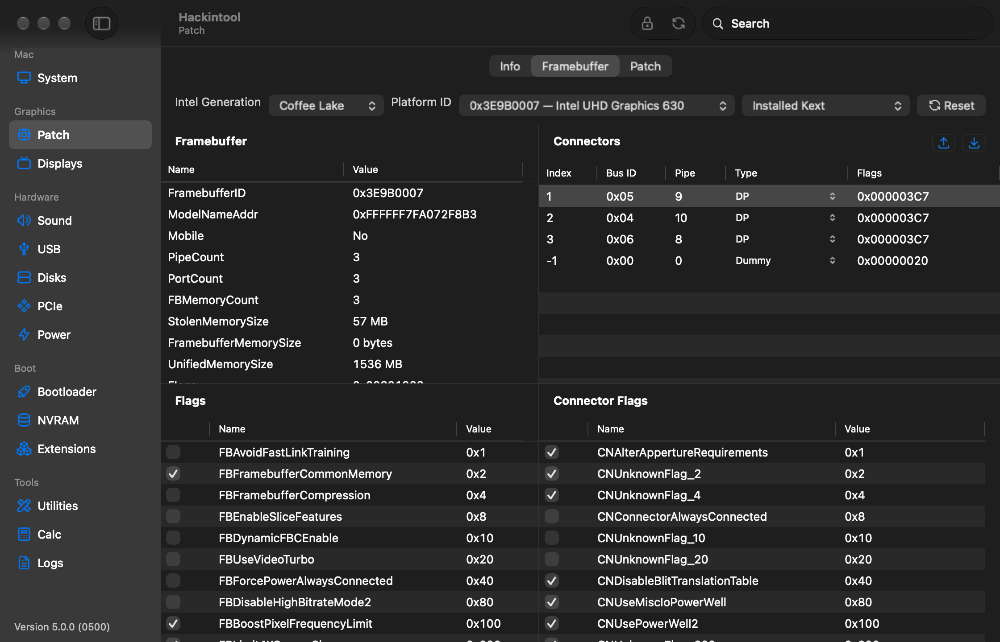

Hackintool is a native macOS app for inspecting and configuring a Hackintosh. It patches Intel framebuffers, maps USB ports, fixes displays and audio, and checks your bootloader and kexts, all in one place.

It's written in Swift and AppKit, runs natively on Intel and Apple Silicon, and supports macOS 12 Monterey through macOS 26 Tahoe and 27 Golden Gate.

## Features

| Section | What it does |
|---|---|
| **System** | Model, CPU, graphics and platform ID, serial number checks and a serial generator, Mac model specs, and connected peripherals |
| **Patch** | Intel framebuffer patching from Sandy Bridge to Ice Lake: edit framebuffer fields, connectors and flags, then generate WhateverGreen DeviceProperties, KextsToPatch (hex or base64) or an SSDT, and save them straight into your config.plist |
| **Displays** | Connected displays with their framebuffer, port and connection type (HDMI, DP, DVI...), EDID details and fixes, display overrides, HiDPI resolutions and injector kexts |
| **Radeon** | AMD GPU support by family and macOS version, with WhateverGreen device properties and boot-args; points Vega-based Ryzen APUs to NootedRed |
| **Sound** | Audio devices, codecs and their pin configuration, and AppleALC layout IDs |
| **USB** | Live port discovery and mapping, connector types, and USBPorts.kext, SSDT-USBX and SSDT-UIAC export |
| **Disks** | EFI partitions and the full partition scheme, with mount, unmount and boot EFI selection |
| **PCIe** | Every PCI device with names, device paths and ACPI paths; export as DeviceProperties or an SSDT |
| **Power** | Your pmset settings, editable, with a one-click fix for sleep problems caused by hibernation |
| **Bootloader** | Detects OpenCore or Clover, checks for updates and applies common config.plist patches, including AMD Vanilla kernel patches with your core count filled in |
| **NVRAM** | View and edit NVRAM variables |
| **Extensions** | Installed kexts compared with the latest releases, with download and build from source |
| **Utilities** | Install kexts, rebuild the kext cache, dump ACPI tables, export Windows Bluetooth and UTC registry files, and run AppleIntelInfo |
| **Calc** and **Logs** | A hex and byte calculator, and the bootloader, Lilu and system logs |

Generated plists can be viewed as an editable tree or as XML. Hackintool updates itself through Sparkle and is available in 12 languages.

<strong>More screenshots</strong>

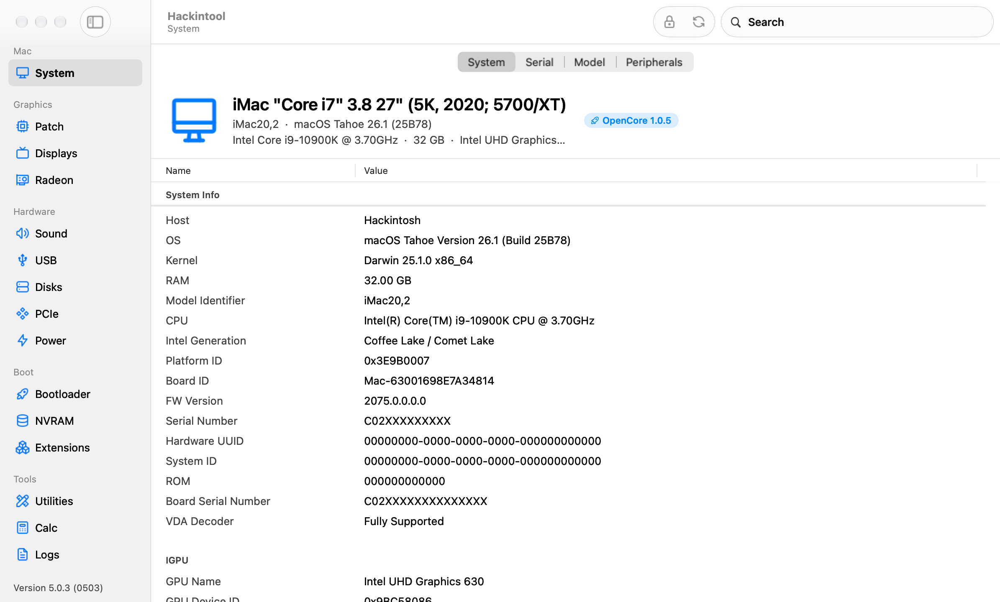

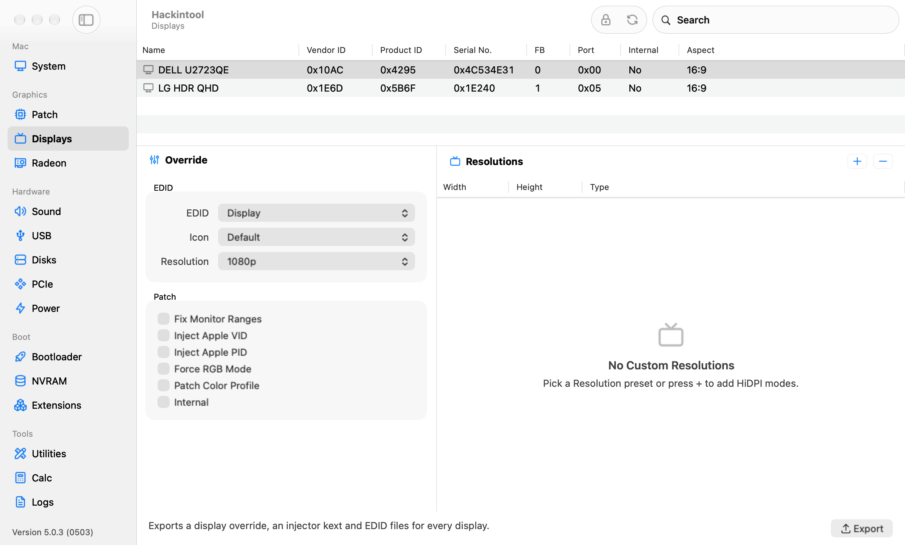

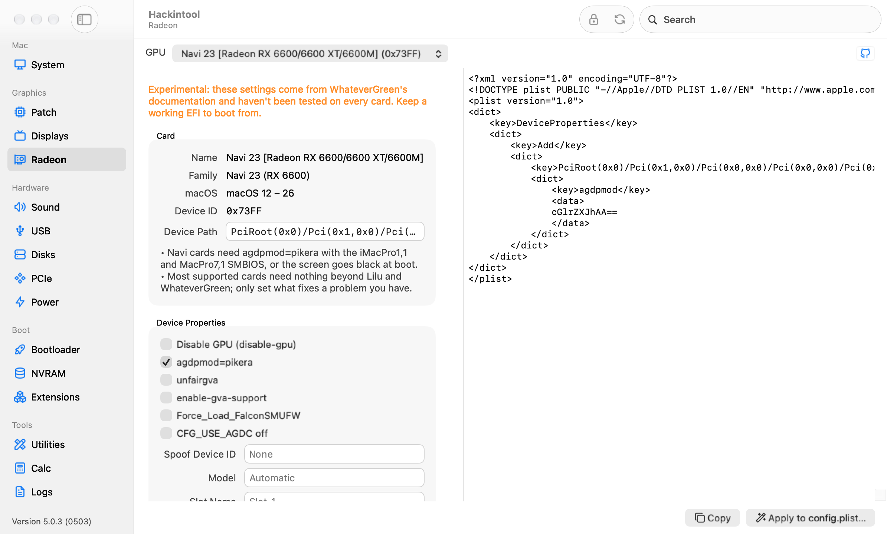

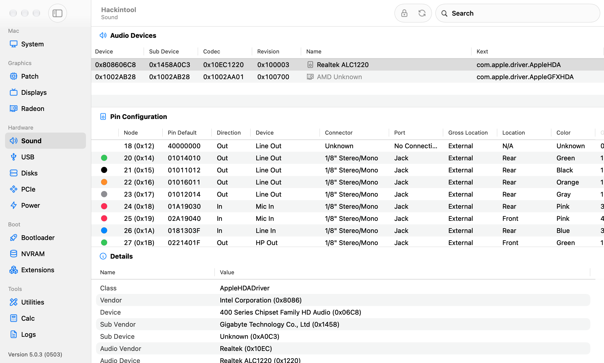

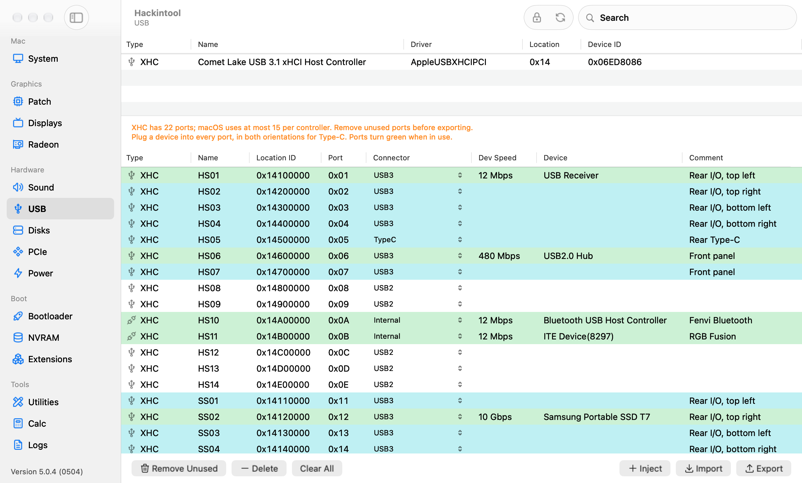

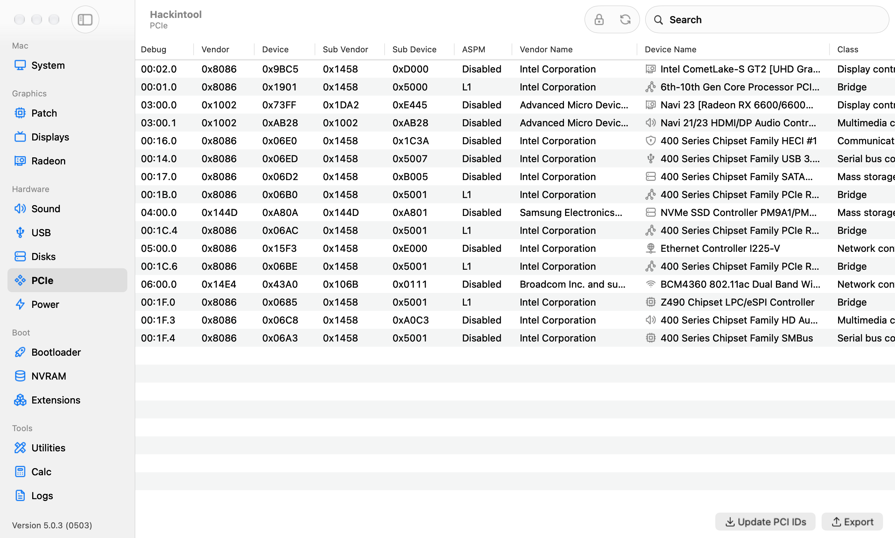

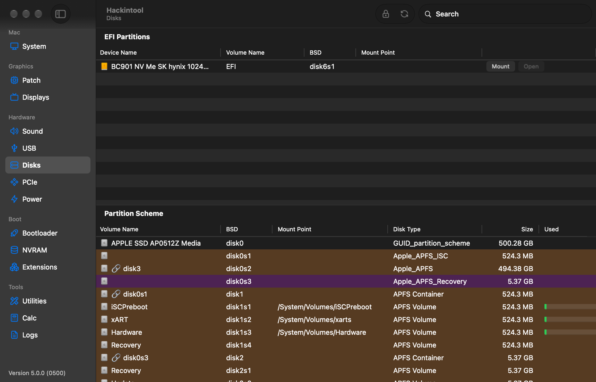

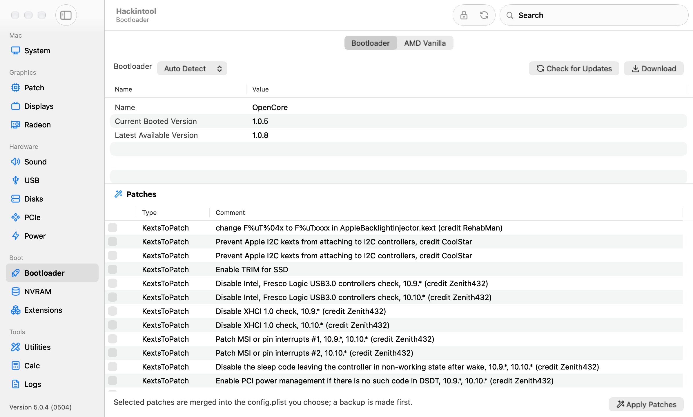

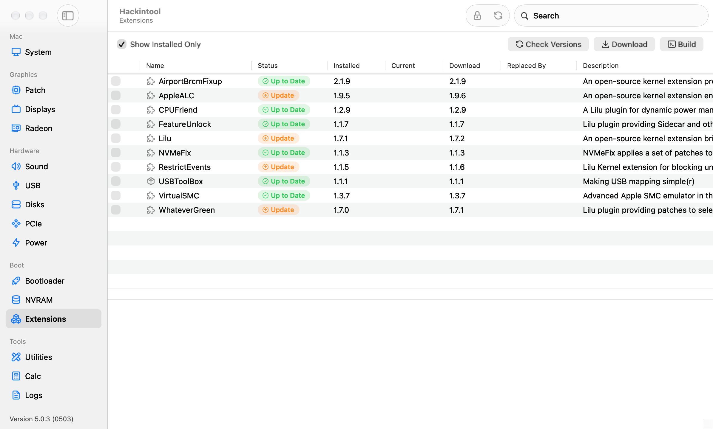

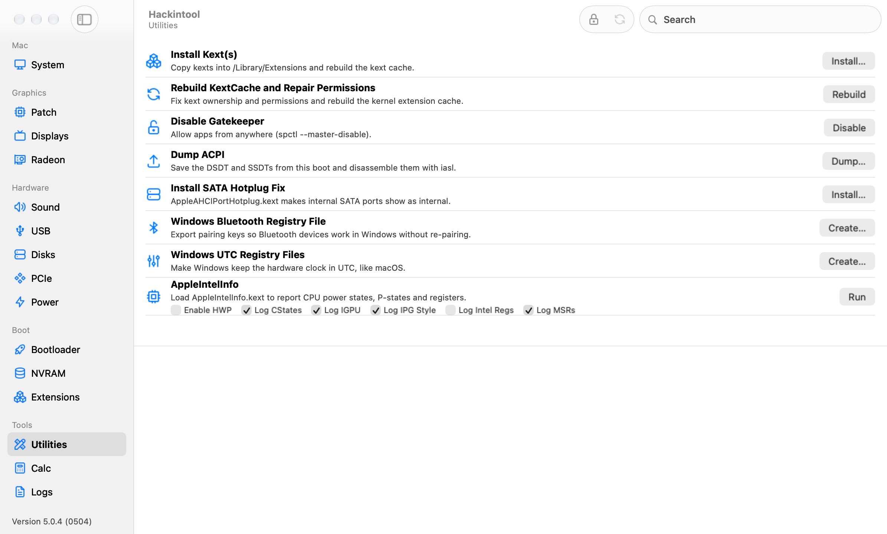

Screenshots show a made-up Comet Lake desktop, not a real machine.

## Installation

1. Download **Hackintool.zip** from the [latest release](https://github.com/benbaker76/Hackintool/releases/latest).
2. Unzip it and move **Hackintool.app** to your Applications folder.
3. Open it. The app is signed but not notarized, so the first time macOS may ask you to confirm. If it does, right-click the app and choose **Open**, or go to **System Settings › Privacy & Security** and click **Open Anyway**.

After that, Hackintool keeps itself up to date.

## Framebuffer data

The **Framebuffer** menu chooses where the Patch section reads Intel framebuffer tables from:

- **Installed Kext** reads your installed Intel framebuffer kext, falling back to the bundled tables on recent macOS versions that no longer ship it.
- **macOS 10.13.6** and **macOS 10.14** use the bundled tables.
- **IOReg Dump (Native / Patched)** reads the tables WhateverGreen publishes when you boot debug WhateverGreen and Lilu with `-igfxfbdump`.

New to framebuffer patching? The [WhateverGreen Intel HD manual](https://github.com/acidanthera/WhateverGreen/blob/master/Manual/FAQ.IntelHD.en.md) and the [Dortania OpenCore guide](https://dortania.github.io/OpenCore-Install-Guide/) are good places to start.

## Building from source

Open `Hackintool.xcodeproj` in Xcode and build the **Hackintool** scheme. The app is Swift and AppKit, with a few C and C++ components (gfxutil, macserial and the VDA decoder check).

## Support development

If you find Hackintool useful and want to support its development:

- Patreon: <https://patreon.com/Baker76>
- Ko-fi: <https://ko-fi.com/benbaker76>
- Buy Me a Coffee: <https://buymeacoffee.com/benbaker76>
- GitHub Sponsors: <https://github.com/sponsors/benbaker76>
- PayPal: <https://paypal.me/benbaker1976>

## Credits

- vit9696 for [WhateverGreen](https://github.com/acidanthera/WhateverGreen) ([full credits](https://github.com/acidanthera/WhateverGreen#credits)), [Lilu](https://github.com/acidanthera/Lilu) ([full credits](https://github.com/acidanthera/Lilu#credits)), [AppleALC](https://github.com/acidanthera/AppleALC) ([full credits](https://github.com/acidanthera/AppleALC#credits)), USBPorts.kext and additional help
- vit9696 for [IntelFramebuffer.bt](https://github.com/acidanthera/WhateverGreen/blob/master/Manual/IntelFramebuffer.bt) with additional work by bcc9, Piker-Alpha and joevt
- daliansky for Intel Core Platform ID and SMBIOS Quick Reference
- Clover Development Team for various technical info
- vandroiy2013 for audio id data from [AppleALC](https://github.com/acidanthera/AppleALC)
- RehabMan for all data patching method, ioreg framebuffer dump and other contributions
- EDID injection (Andy Vandijck / Marchrius)
- USB power injection (corpnewt)
- HDA controllers / codec lists by the VoodooHDA project
- System Configs compilation (CaseySJ)
- Clover downloader (Kozlek / JrCs / slice)
- Kext compiler & installer (Sascha Lamprecht / Gengik84 / LAbyOne)
- Atheros & SATA kexts (Sascha Lamprecht)
- DPCIManager (phpdev32 / MuntashirAkon)
- AppleIntelInfo (Pike R. Alpha)
- gfxutil (mcmatrix)
- VDADecoderChecker (Andy Breuhan)
- iMessageDebug (ElNono / mdmwii / flux84 / sugarface / pokenguyen)
- macserial (vit9696 / [OpenCorePkg](https://github.com/acidanthera/OpenCorePkg/tree/master/Utilities/macserial))
- Model data (everymac.com)
- Translations: French (Matgen84), German (al6042), Korean (zisqo), Russian / Ukrainian (ctich), Chinese (daliansky, Bat.bat, penghubingzhou)
- Sparkle framework by Andy Matuschak
- Icon & UI updates by ultratiem
- USB mapping approach from [USBMap](https://github.com/corpnewt/USBMap) (corpnewt)
- Icons from [Tabler Icons](https://tabler.io/icons) (MIT)
- Property list editor ported from [LNPropertyListEditor](https://github.com/LeoNatan/LNPropertyListEditor) by Leo Natan (MIT)

## License

Hackintool is released under the [MIT License](LICENSE.md).
