

# Hackintool

**The Swiss army knife of vanilla Hackintoshing**

[**Download**](https://github.com/benbaker76/Hackintool/releases/latest) · [Report a bug](https://github.com/benbaker76/Hackintool/issues) · [Support development](#support-development)

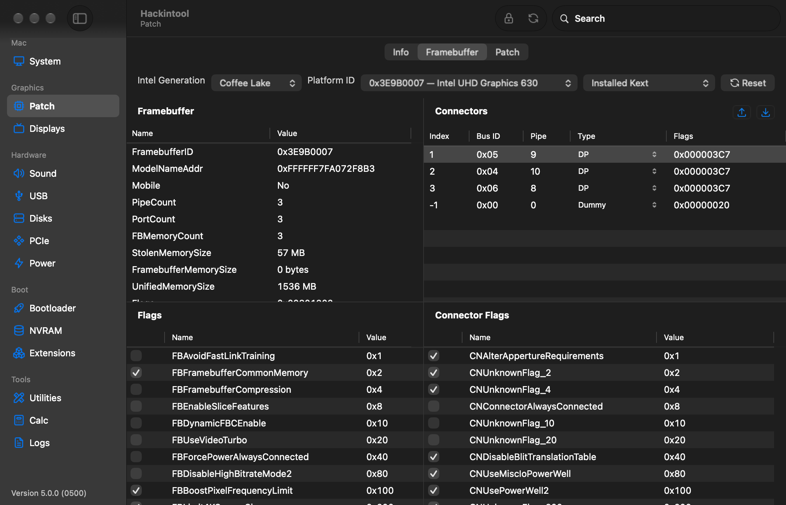

Hackintool helps you inspect and configure a Hackintosh: patch Intel framebuffers, map USB ports, fix displays and audio, check your bootloader and kexts, and much more, all in one native macOS app.

## What's new in 5.0

- **Rewritten in Swift** with a new native interface: a sidebar, a toolbar with search, and dark mode throughout.
- **Universal app**, running natively on Intel and Apple Silicon (macOS 12 or later).
- **USB mapping brought up to date** with [USBMap](https://github.com/corpnewt/USBMap), including macOS 26 (Tahoe) port properties, the 15-port limit and controller renames.
- **Windows Bluetooth export rewritten** for macOS 12 and later, including Bluetooth LE keys.
- **macOS 26 Tahoe and 27 Golden Gate** support, with refreshed PCI/USB IDs, Mac model data, AppleALC codec lists and macserial.
- Many long-standing bugs fixed in framebuffer patching, EDID fixes and more.

> [!IMPORTANT]
> **Updating from 4.x?** Version 5.0 is signed with a new key, so 4.x can't update to it automatically. Download it once [from the releases page](https://github.com/benbaker76/Hackintool/releases/latest); after that, updates arrive automatically again. Your settings carry over.

## Features

| Section | What it does |
|---|---|
| **System** | Model, CPU, Intel graphics generation and platform ID, serial number checks and a serial generator, Mac model specs, and connected peripherals |
| **Patch** | Intel framebuffer patching from Sandy Bridge to Ice Lake (Comet Lake via the Coffee Lake framebuffer): edit framebuffer fields, connectors and flags, then generate WhateverGreen DeviceProperties, KextsToPatch (hex or base64) or an SSDT, and save straight into your config.plist |
| **Displays** | EDID details and fixes, display overrides and HiDPI scaled resolutions, and injector kexts |
| **Radeon** | AMD GPU support check by family and macOS version, and WhateverGreen device properties and boot-args (experimental); points Vega-based Ryzen APUs to NootedRed |
| **Sound** | Audio devices, codecs and their pin configuration, and AppleALC layout IDs |
| **USB** | Live port discovery and mapping, connector types, and USBPorts.kext / SSDT-USBX export |
| **Disks** | Partitions and EFI partitions, with mount and unmount |
| **PCIe** | Every PCI device with names, device paths and ACPI paths; export as DeviceProperties or an SSDT |
| **Power** | Your pmset power settings, editable, with a one-click fix for sleep problems caused by hibernation |
| **Bootloader** | Detects OpenCore or Clover, checks for updates and applies common patches to your config.plist; AMD Vanilla kernel patches for AMD CPUs with your core count filled in |
| **NVRAM** | View and edit NVRAM variables |
| **Extensions** | Installed kexts against the latest releases, with download and build from source |
| **Utilities** | Install kexts, rebuild the kext cache, dump ACPI tables, Windows Bluetooth and UTC registry files, AppleIntelInfo |
| **Calc** and **Logs** | A hex/byte calculator, and boot, Lilu and system logs |

<strong>More screenshots</strong>

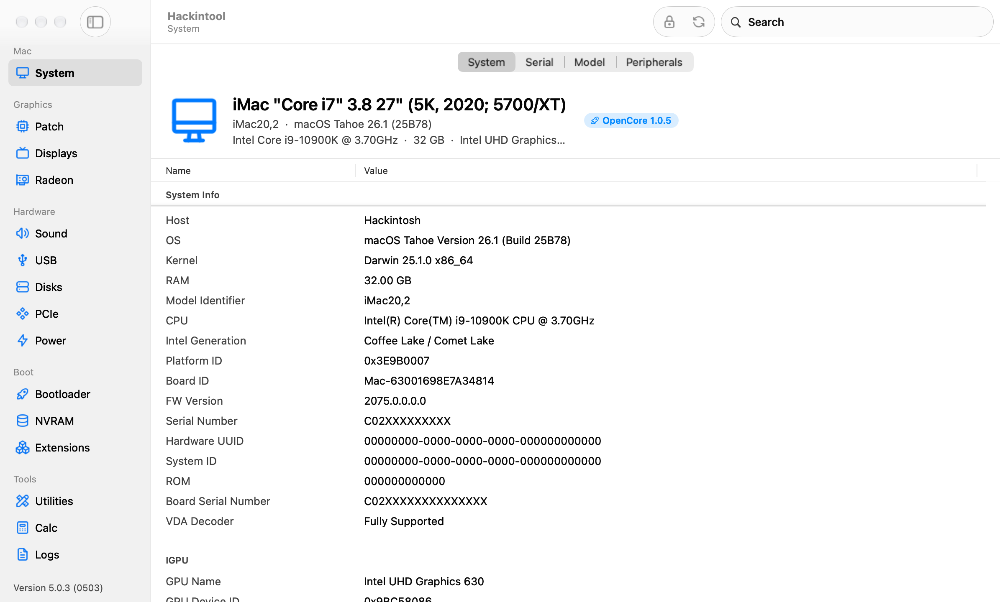

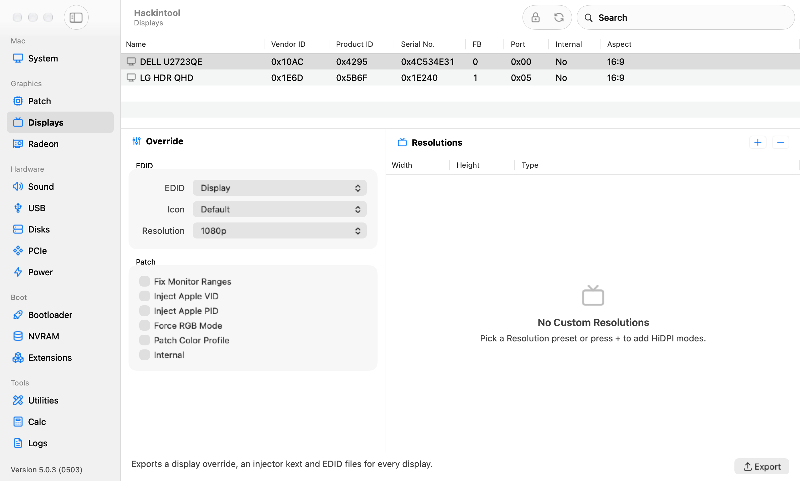

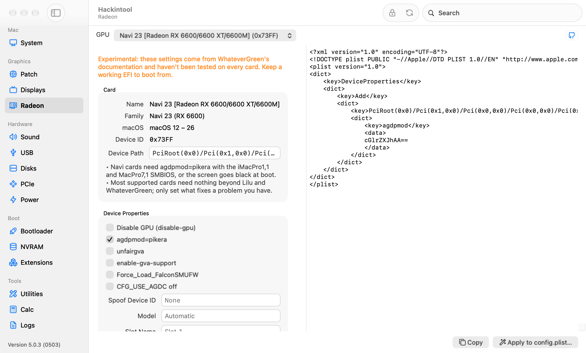

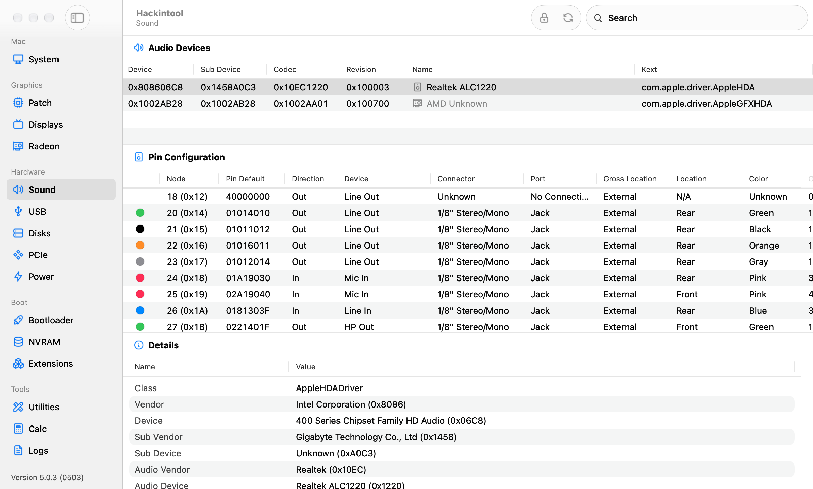

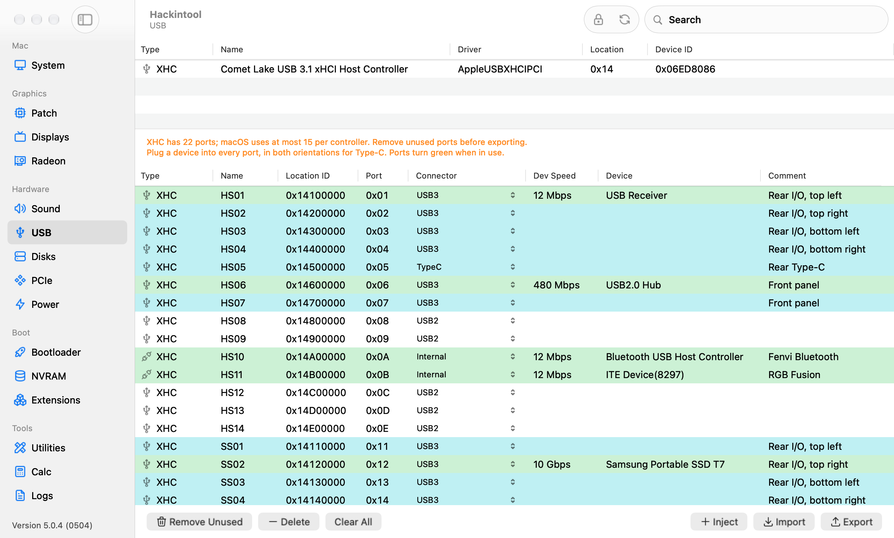

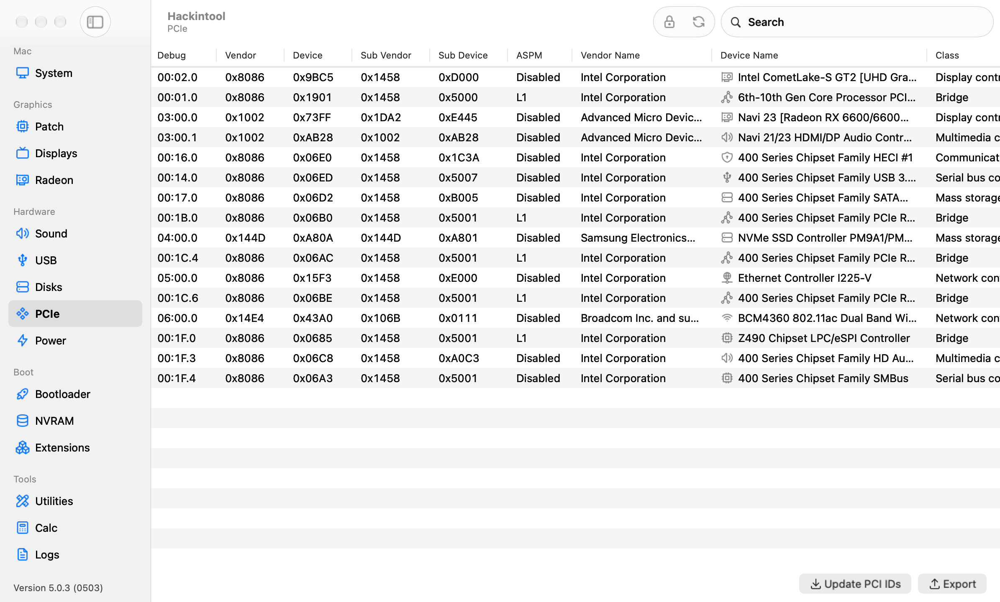

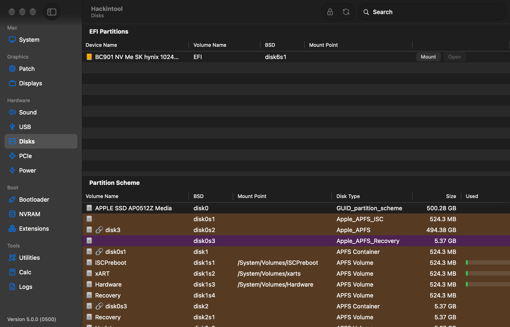

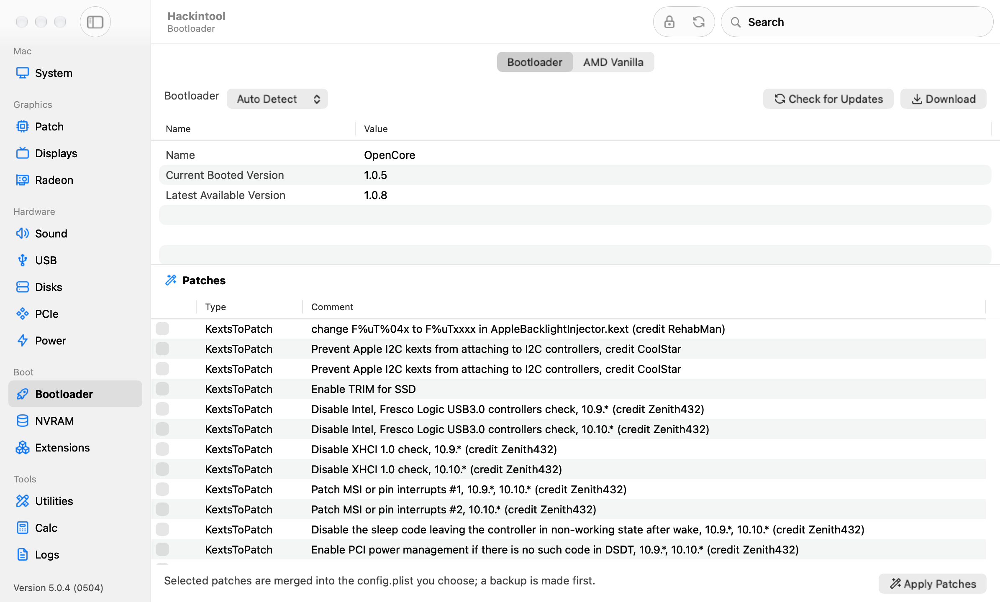

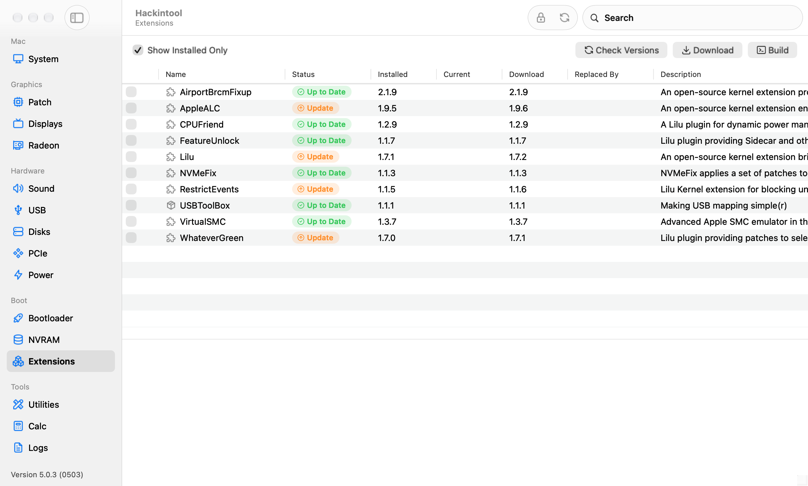

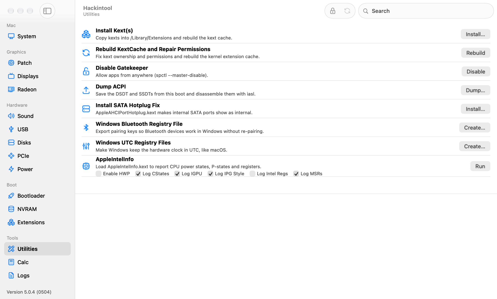

Screenshots show a made-up Comet Lake desktop, not a real machine.

## Before you start

> [!WARNING]
> Hackintool isn't an automated tool that does all the work for you. **You need to know how patching works before using it.** Please read these guides first:
>
> - [Intel Framebuffer patching using WhateverGreen](https://www.tonymacx86.com/threads/guide-intel-framebuffer-patching-using-whatevergreen.256490/)
> - [An iDiot's Guide To Lilu and its Plug-ins](https://www.tonymacx86.com/threads/an-idiots-guide-to-lilu-and-its-plug-ins.260063/) by @jaymonkey
> - [General Framebuffer Patching Guide using Hackintool](https://www.tonymacx86.com/threads/guide-general-framebuffer-patching-guide-hdmi-black-screen-problem.269149) by @CaseySJ

### Where framebuffer data comes from

Choose the source in the **Framebuffer** menu:

- **Installed Kext** reads the framebuffer table from your installed Intel framebuffer kext. When it isn't available (it no longer ships with recent macOS), Hackintool falls back to its bundled tables.
- **macOS 10.13.6 / macOS 10.14** use the bundled tables, so you can create patches without a dump.
- **IOReg Dump (Native / Patched)** reads the tables WhateverGreen publishes when you boot with the `-igfxfbdump` flag (needs the debug versions of WhateverGreen and Lilu).

## Installation

1. Download **Hackintool.zip** from the [latest release](https://github.com/benbaker76/Hackintool/releases/latest).
2. Unzip it and move **Hackintool.app** to your Applications folder.
3. Open it. The app is signed but not yet notarized, so the first time macOS may warn you. If it does, right-click the app and choose **Open**, or go to **System Settings › Privacy & Security** and click **Open Anyway**.

Hackintool requires **macOS 12 Monterey or later**.

## Building from source

Open `Hackintool.xcodeproj` in Xcode and build the **Hackintool** scheme. The app is written in Swift and AppKit, with a few C and C++ components (gfxutil, macserial and the VDA decoder check).

## Support development

If you find Hackintool useful and want to support its development:

- Patreon: <https://patreon.com/Baker76>
- Ko-fi: <https://ko-fi.com/benbaker76>
- Buy Me a Coffee: <https://buymeacoffee.com/benbaker76>
- GitHub Sponsors: <https://github.com/sponsors/benbaker76>
- PayPal: <https://paypal.me/benbaker1976>

## Credits

- vit9696 for [WhateverGreen](https://github.com/acidanthera/WhateverGreen) ([full credits](https://github.com/acidanthera/WhateverGreen#credits)), [Lilu](https://github.com/acidanthera/Lilu) ([full credits](https://github.com/acidanthera/Lilu#credits)), [AppleALC](https://github.com/acidanthera/AppleALC) ([full credits](https://github.com/acidanthera/AppleALC#credits)), USBPorts.kext and additional help
- vit9696 for [IntelFramebuffer.bt](https://github.com/acidanthera/WhateverGreen/blob/master/Manual/IntelFramebuffer.bt) with additional work by bcc9, Piker-Alpha and joevt
- daliansky for Intel Core Platform ID and SMBIOS Quick Reference
- Clover Development Team for various technical info
- vandroiy2013 for audio id data from [AppleALC](https://github.com/acidanthera/AppleALC)
- RehabMan for all data patching method, ioreg framebuffer dump and other contributions
- EDID injection (Andy Vandijck / Marchrius)
- USB power injection (corpnewt)
- HDA controllers / codec lists by the VoodooHDA project
- System Configs compilation (CaseySJ)
- Clover downloader (Kozlek / JrCs / slice)
- Kext compiler & installer (Sascha Lamprecht / Gengik84 / LAbyOne)
- Atheros & SATA kexts (Sascha Lamprecht)
- DPCIManager (phpdev32 / MuntashirAkon)
- AppleIntelInfo (Pike R. Alpha)
- gfxutil (mcmatrix)
- VDADecoderChecker (Andy Breuhan)
- iMessageDebug (ElNono / mdmwii / flux84 / sugarface / pokenguyen)
- macserial (vit9696 / [OpenCorePkg](https://github.com/acidanthera/OpenCorePkg/tree/master/Utilities/macserial))
- Model data (everymac.com)
- Translations: French (Matgen84), German (al6042), Korean (zisqo), Russian / Ukrainian (ctich), Chinese (daliansky, Bat.bat, penghubingzhou)
- Sparkle framework by Andy Matuschak
- Icon & UI updates by ultratiem
- USB mapping approach from [USBMap](https://github.com/corpnewt/USBMap) (corpnewt)
- Icons from [Tabler Icons](https://tabler.io/icons) (MIT)
- Property list editor ported from [LNPropertyListEditor](https://github.com/LeoNatan/LNPropertyListEditor) by Leo Natan (MIT)

## Release history

See the [releases page](https://github.com/benbaker76/Hackintool/releases) for recent versions.

<strong>Older versions (1.0.0 to 2.8.6)</strong>

- 2.8.6 - Fix crash in getEDIDData, fix Import KextsToPatch
- 2.8.5 - Add "Show Installed Only" option for installed kexts
- 2.8.4 - Improved framebuffer enumeration, updated codecs and pci.ids
- 2.8.3 - Improved version checking routine, updated Turkish translation
- 2.8.2 - Updated Clover download location / OpenCore download support, Chinese translation update
- 2.8.1 - Data file updates
- 2.8.0 - Fixed OpenCore KextsToPatch format. Removed DSDT Rename auto selection
- 2.7.9 - Source is now on Github [here](https://github.com/benbaker76/Hackintool)
- 2.7.8 - Fix pcidevices.dsl compile error
- 2.7.7 - pcidevices.dsl export will now compile. Fix for Device Path
- 2.7.6 - Custom Device Path generation code (big thanks to [@jaymonkey](https://www.tonymacx86.com/members/195809/) for helping test). Updated Chinese translation
- 2.7.5 - PCI DevicePath fix
- 2.7.4 - Added EveryMac.com Serial Check
- 2.7.3 - Added Serial Number Generator (thanks to vit9696 / MacInfoPkg team)
- 2.7.2 - Added EDID injection to IGPU. Added DPCD Max Link Rate patching. Added tooltips for Advanced / LSPCON patch options. Updated pci.ids / AppleALC audio data
- 2.7.1 - Bug fixes. Updated pci.ids / AppleALC audio data
- 2.7.0 - Launch process output fix (big thanks to [@jaymonkey](https://www.tonymacx86.com/members/195809/) for the help testing this). Prepends "Intel" for IGPU name for Intel Power Gadget (thanks again to [@jaymonkey](https://www.tonymacx86.com/members/195809/) for discovering this). System Info now includes all graphics cards. iMessage Keys are now clearly labeled. Added new OpenCore logo. Updated pci.ids / AppleALC audio data
- 2.6.9 - Disable Gatekeeper tool fix
- 2.6.8 - Catalina fixes
- 2.6.7 - Added "HDMI Infinite Loop Fix". Added LSPCON patching. Fixes
- 2.6.6 - Added "Disable Gatekeeper and mount the disk in read/write mode" tool. Change GFX0 to IGPU selection no longer shows for dGPU
- 2.6.5 - Improved BT hardware detection (when installed) and will show if FW Loaded (if using BrcmPatchRAM)
- 2.6.4 - Fixes
- 2.6.3 - Added Atheros BT device detection
- 2.6.2 - Added Bluetooth to Info->Misc
- 2.6.1 - Fixed USB device speeds
- 2.6.0 - USB fixes for macOS Catalina. USB now shows device speeds. Much improved Log viewer. Installing kexts on macOS Catalina will prompt to disable Gatekeeper and mount the disk in read/write mode. Fixed Atheros install for macOS Catalina. Added NativeDisplayBrightness to kext install list. Updated translations for Korean / Chinese
- 2.5.9 - ACPI names must be 4 characters (thanks P1LGRIM)
- 2.5.8 - Now using pci.ids for Audio Controllers
- 2.5.7 - Removed kextcache -u / call for rebuild cache. Added more command output for tools
- 2.5.6 - Added column sorting to PCI table
- 2.5.5 - Added ASRock DeskMini 310 system config
- 2.5.4 - Will now output mounting errors
- 2.5.3 - Fixed EveryMac.com Visit link
- 2.5.2 - Added Host, OS, Kernel and RAM System Info
- 2.5.1 - Add support for 0x3EA50005 0x3EA60005 0x3E980003 frame id for CFL refresh
- 2.5.0 - Fixed stdout/stderr output capture for admin privilege shell commands (thanks jaymonkey)
- 2.4.9 - Fixes
- 2.4.8 - Fixes
- 2.4.7 - Fixes
- 2.4.6 - "Rebuild KextCache and Repair Permissions" moved to tools section now has progress bar
- 2.4.5 - Output added for "Rebuild KextCache and Repair Permissions"
- 2.4.4 - Chinese language updates. Compiler improvements
- 2.4.3 - Chinese language updates. USB configurator fixes
- 2.4.2 - Changed Framebuffer Info to Selected / Current Framebuffer Info for easier comparison
- 2.4.1 - Chinese language update
- 2.4.0 - Now includes iMessageDebug data (ElNono / mdmwii / flux84 / sugarface / pokenguyen). Export system info data. View model info (everymac.com). Check serial feature. Preliminary OpenCore support (thanks vit9696)
- 2.3.9 - ComboBox fix (thanks telepati)
- 2.3.8 - Bug fixes (thanks ReddestDream)
- 2.3.7 - Improved Clover EFI Mounting. Clover PCI export now uses SubClass for device_type
- 2.3.6 - Bug fixes. "Use Intel HDMI" option added (hda-gfx=onboard-x). Added "Non Scaled" resolution type
- 2.3.5 - Fixed bug in Device Path generator (gfxutil). Added "Generate Windows UTC Registry Files" tool
- 2.3.4 - Updated audio codecs, Export PCI list in Clover and dsl format, Now dumps all ACPI tables and decompiles to dsl
- 2.3.3 - Extract DSDT (phpdev32), Auto update PCIIDs (MuntashirAkon), Export PCI list in JSON format
- 2.3.2 - Monitor PCI hotplug
- 2.3.1 - UI Updates
- 2.3.1 - Right-click on a PCI device and select "Copy IOReg Path". Launch IORegistryExplorer and select Go->Go to Path... menu, paste in the path and click the "Go to Path" button.
- 2.2.8 - Added warning for HWP state logging (previous state can only be restored after a reboot)
- 2.2.7 - Added VDA Decoder status. Added DevicePath for PCI devices. Export PCI Devices list to desktop
- 2.2.6 - Improved Boot EFI detection. Set Boot EFI manually. AppleIntelInfo shows 30 second timer to log CStates. Restores HWP state after logging. Added Intel Regs warning. Calculator now shows reverse bytes
- 2.2.4 - Added AppleIntelInfo options (Enable HWP, Log: CStates, IGPU, IPG Style, Intel Regs, MSRs). Added AppleIntelInfo 20 second delay for CState capture.
- 2.2.2 - Added Info tab (Network Interfaces, Graphic Devices, Audio Devices and Storage Devices). Will highlight power settings green or red to indicate issues
- 2.2.1 - Fixes
- 2.2.0 - New PCI Devices, Network, Power and Tools tab
- 2.1.9 - Added Github kext downloading. The download version may be older than the source version. Also due to Github API rate limits it will store the latest download urls. Added Install kext(s) function. Added Rebuild KextCache and Repair Permissions function
- 2.1.8 - Uses kextstat to get the versions
- 2.1.7 - Now detects more kexts
- 2.1.6 - Can now download the current version numbers of Lilu + Plugins
- 2.0.8 - Patch->System Configs menu with various configurations you can try if your Coffee Lake system is being troublesome (CaseySJ)
- 2.0.4 - Apply Clover patches (KernelToPatch, KextToPatch, DSDT Renames). View, create and edit NVRAM variables (be careful!). View installed Lilu + Plugins, download and automatically compile the latest versions
- 1.9.6 - Disk display enhancements (icons / mount / unmount buttons)
- 1.9.2 - Fixes
- 1.9.1 - Added SSDT-UIAC.aml / SSDT-USBX.aml export support
- 1.9.0 - Fixed launch bug (thanks [@Pavo](https://www.tonymacx86.com/members/9658/))
- 1.8.7 - Added USB Power DSDT Renames
- 1.8.6 - Added DSDT Renames
- 1.8.5 - Fixes
- 1.8.4 - Auto update capability using Sparkle framework
- 1.8.3 - Improved Audio Device detection / selection, window can now be resized
- 1.8.2 - Added translations; French (Matgen84), German (al6042), Korean (zisqo), Russian / Ukrainian (ctich)
- 1.8.1 - Clover downloader (Kozlek / JrCs / slice), NVRAM boot-args edit, improved authorization, UI update
- 1.8.0 - Improved USB power export (corpnewt), other fixes, new icon
- 1.7.9 - Added USB power export, EFI partition mounting, calculator and log viewer
- 1.7.8 - Added resolution injection from one-key-hidpi script (xzhih)
- 1.7.7 - Added EDID patching support for AMD & nVidia
- 1.7.6 - EDID overrides can now export custom icons
- 1.7.5 - Improved USB guide, added print button
- 1.7.4 - Fixed defaults
- 1.7.3 - Updates
- 1.7.2 - Renamed app to Hackintool, added EDID injection support (Andy Vandijck)
- 1.7.1 - Dark mode fixes
- 1.7.0 - USB & Audio info added, shows possible spoof / kext requirements
- 1.6.9 - Updates
- 1.6.8 - Added framebuffer-camellia and framebuffer-flags patching support
- 1.6.7 - Added Macmini8,1 and MacBookAir8,1 definitions
- 1.6.6 - Data file updates
- 1.6.5 - Fixed USBInjectAll detection
- 1.6.4 - Audio layout id detection improvement
- 1.6.3 - Now shows Audio Controller
- 1.6.2 - USB fixes
- 1.6.1 - Improved Spoof Audio Device Id option
- 1.6.0 - Fixes
- 1.5.9 - Now shows USB Controllers
- 1.5.8 - Will store and restore USB ports between app sessions for use with new USBInjectAll.kext (0.7.0) to include boot flags for excluding groups of ports
- 1.5.7 - Now detects EHC and hub ports (thanks to RehabMan & SavageAUS). Multi-select USB Ports. Now detects if USBInjectAll is installed
- 1.5.4 - Fixed audio codec detection when user has multiple audio devices. Added "Reboot Fix" advanced patch (sets connector pipe values to 18)
- 1.5.3 - Improved Export->Clover config.plist and now makes a backup (config-backup.plist)
- 1.5.2 - Added Patch->AzulPatcher4600
- 1.5.1 - USBPorts port-count fix
- 1.5.0 - Fixes
- 1.4.9 - Added tab to show if Lilu, WhateverGreen and AppleALC are installed and version info
- 1.4.8 - Fixed framebuffer-cursormem output for iASL DSL Source patching
- 1.4.7 - Added support for new WEG -igfxfbdump boot flag using File->Import->IOReg Dump menu
- 1.4.6 - Fixes. Added Framebuffer->macOS 10.14 menu item. Added QE/CI and Metal support detection
- 1.4.5 - Added support for framebuffer-cursormem (Haswell)
- 1.4.4 - Added ability to inject valid device-id's
- 1.4.3 - Fixes
- 1.4.2 - Added Patch->Import KextsToPatch / Apply Current Patches menu. Renamed USBPower.kext -> USBPorts.kext
- 1.4.1 - Added TypeC USB ports
- 1.4.0 - Improved Intel Generation detection
- 1.3.9 - Now using AppleIntelFramebuffer@X index for connector association
- 1.3.8 - Fixed bug AppleIntelFramebuffer port-number should be connecter index + 4 or 0 for internal (RehabMan)
- 1.3.7 - Shows Display Info for connected displays on connector ports (with display hot plug support), fixed iASL DSL Source hex output, connector drag-drop to change order
- 1.3.6 - Fixes
- 1.3.5 - Will try HDAS if HDEF is not found
- 1.3.4 - Added AllData connector patch method (RehabMan). Will try GFX0 if IGPU is not found
- 1.3.3 - Fixes. Added more audio layout-id's (vandroiy2013)
- 1.3.2 - Fixes
- 1.3.1 - Fixes. Added new menu Framebuffer->Current Version / macOS 10.13.6
- 1.3.0 - Added audio patching, Clover config.plist exporting, USB patching, advanced auto patching
- 1.2.8 - Added iASL DSL Source patch output, display detected Intel gen and platform-id
- 1.2.7 - File->Export framebuffer text file
- 1.2.6 - Fix preallocated memory calculation formula (vit9696)
- 1.2.5 - Still outputs a config.plist/Devices/Properties patch when "Auto Detect Changes" is selected
- 1.2.4 - Fixes
- 1.2.3 - config.plist/Devices/Properties patch now outputs data format
- 1.2.2 - Fixes
- 1.2.1 - Updates and fixes
- 1.2.0 - Added support for Cannon Lake and Ice Lake
- 1.1.0 - Added MacBookPro15,1 and MacBookPro15,2 models
- 1.0.9 - Support for Mojave, Coffee Lake, WhateverGreen's -igfxdump boot flag and Clover's config.plist/Devices/Properties patch output
- 1.0.8 - Updates
- 1.0.7 - Fixed support for dark mode
- 1.0.6 - Better backwards compatibility
- 1.0.5 - Detects Chipset / Address on Startup, Edit Memory Values Easier
- 1.0.4 - Added GPU / Model Info
- 1.0.3 - Added Tooltips
- 1.0.2 - Added Memory tab
- 1.0.1 - Minor Fixes
- 1.0.0 - Initial Release

## License

Hackintool is released under the [MIT License](LICENSE.md).
